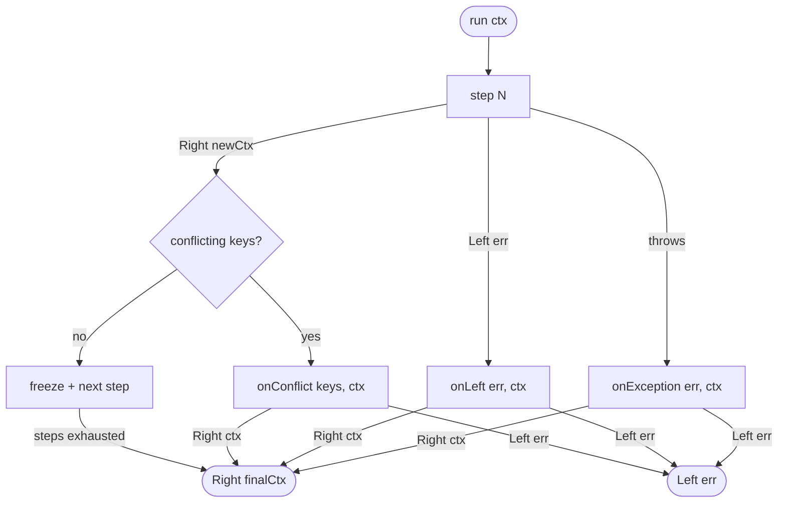

# ADR-001: Pipeline with Railway Oriented Programming on mini-fp

**Status:** Accepted  
**Date:** 2026-04-03  
**Author:** ngwes

---

## Context

`groucho-fp` must provide a pipeline pattern for orchestrating asynchronous functions that can fail. Functions must be able to enrich a shared state (context) in an additive way. On the first failure the pipeline stops and invokes a dedicated handler. The library relies on `mini-fp` (`@ngwes/mini-fp`) for the `Either<L, R>` type.

---

## Decision

Implement a `createPipeline` factory that:

- accepts an array of **steps** — functions `(ctx: Readonly<Ctx>) => Promise<Either<L, Ctx>>`
- accepts an options object with three handlers: `onLeft`, `onException`, `onConflict`
- returns a `Pipeline` object with method `run(ctx: Ctx): Promise<Either<L, Readonly<Ctx>>>`

All steps share the same homogeneous signature. The context is the only shared state: each step receives the current context and returns an enriched new context. Steps are agnostic to each other — they only know `Ctx` and `L`, they do not import one another.

The three handlers all follow the same pattern — they receive information about the error plus the context at the moment of failure, and return `Promise<Either<L, Ctx>>`. They can therefore **recover** (by returning `Right`) or propagate the failure (by returning `Left`). Their return value becomes the result of `run`.

**Resource cleanup** (rollback, closing connections) should be done in the handlers — the pipeline has no autonomous rollback mechanism.

### Public types

```typescript
type Step<L, Ctx> = (ctx: Readonly<Ctx>) => Promise<Either<L, Ctx>>;

interface PipelineOptions<L, Ctx> {
  onLeft:     (err: L,                               ctx: Readonly<Ctx>) => Promise<Either<L, Ctx>>;
  onException:(err: unknown,                         ctx: Readonly<Ctx>) => Promise<Either<L, Ctx>>;
  onConflict: (conflictingKeys: ReadonlyArray<string>, ctx: Readonly<Ctx>) => Promise<Either<L, Ctx>>;
}

interface Pipeline<L, Ctx> {
  run(ctx: Ctx): Promise<Either<L, Readonly<Ctx>>>;
}

function createPipeline<L, Ctx extends object>(
  steps: ReadonlyArray<Step<L, Ctx>>,
  options: PipelineOptions<L, Ctx>
): Pipeline<L, Ctx>;
```

### Execution flow



### Internal execution loop

```typescript
async run(ctx: Ctx): Promise<Either<L, Readonly<Ctx>>> {
  let current: Readonly<Ctx> = Object.freeze({ ...ctx });

  for (const step of steps) {
    let result: Either<L, Ctx>;
    try {
      result = await step(current);
    } catch (err) {
      return options.onException(err, current);
    }

    if (result.isLeft()) {
      return options.onLeft(result.unwrapLeft(), current);
    }

    const next = result.unwrapRight();
    const conflictingKeys = (Object.keys(next) as Array<keyof Ctx>).filter(
      (k) => current[k] !== undefined && next[k] !== current[k]
    );

    if (conflictingKeys.length > 0) {
      return options.onConflict(conflictingKeys as string[], current);
    }

    current = Object.freeze(next);
  }

  return Either.right(current);
}
```

### Usage example

```typescript
type AppError =
  | { tag: 'validation'; message: string }
  | { tag: 'not_found';  userId: string }
  | { tag: 'send_failed' };

type AppContext = {
  db:     Database;
  mailer: Mailer;
  userId: string;

  validatedId?: string;               // added by validateUserId
  user?:        { id: string; email: string }; // added by fetchUser
};

const pipeline = createPipeline<AppError, AppContext>(
  [validateUserId, fetchUser, sendWelcomeEmail],
  {
    onLeft: async (err, ctx) => {
      await ctx.db.rollback();
      return Either.left(err);
    },
    onException: async (err, ctx) => {
      await ctx.db.rollback();
      console.error('Unexpected crash', err);
      return Either.left({ tag: 'send_failed' });
    },
    onConflict: async (keys, ctx) => {
      console.error('Conflict on keys:', keys);
      return Either.left({ tag: 'validation', message: `conflict: ${keys.join(', ')}` });
    },
  }
);

const result = await pipeline.run({ db, mailer, userId: req.params.id });

result.match(
  (finalCtx) => res.json({ userId: finalCtx.user?.id }),
  (err)      => res.status(400).json(err),
);
```

---

## Consequences

### Positive

- **Homogeneous and agnostic step signature**: each step only knows `Ctx` and `L`, with no dependencies on other steps
- The three handlers follow the same pattern: `(errorInfo, ctx) => Promise<Either<L, Ctx>>` — they can recover (Right) or propagate (Left)
- `run` returns `Either` → the caller reacts programmatically without coupling to side effects
- `Object.freeze` + conflict detection guarantee runtime immutability of previously written values

### Negative / Trade-offs

- `Ctx` must declare all possible fields upfront, some optional — TypeScript cannot guarantee at compile time that an optional field is present when a step needs it
- Conflict detection is runtime only — there is no static guarantee that a step will not overwrite a previous field
- **`Object.freeze` is shallow**: nested objects inside `Ctx` remain mutable in depth
- Cleanup is the handlers' responsibility — the pipeline has no automatic rollback

### Documented edge cases

- **Empty pipeline**: `createPipeline([], options).run(ctx)` → returns `Right(ctx)` without invoking any handler
- **Handler that throws**: the exception propagates to the caller of `run`
- **Handler that returns `Right`**: the value becomes the final result of `run` — the pipeline does not resume subsequent steps

---

## Alternatives considered

- **`PipelineError<L>` as a single type** — rejected: forces a switch on the tag; separate handlers with specific types are more direct
- **Variadic generics for Ctx** — rejected: excessive TypeScript complexity; the benefit (no optional fields) does not justify the loss of readability and maintainability
- **`run` returning `Promise<void>`** — rejected: the caller cannot react programmatically to the result
- **Step returning `Partial<Ctx>`** — rejected: in favour of returning the full Ctx, consistent with the handler signature
- **L per step with automatic union** — rejected: a shared `L` (discriminated union) is the standard practice
