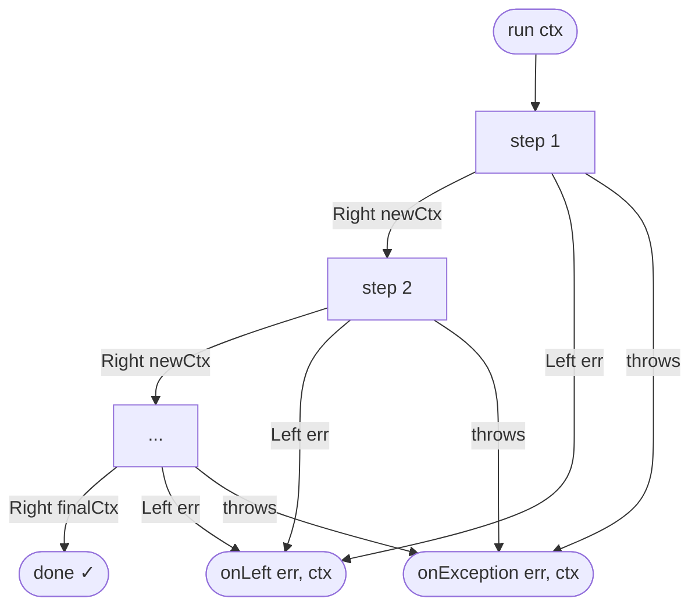

# ADR-001: Pipeline con Railway Oriented Programming su mini-fp

**Status:** Accepted  
**Date:** 2026-04-03  
**Author:** ngwes

---

## Context

`groucho-fp` deve fornire un pattern pipeline per orchestrare funzioni asincrone che possono fallire. Le funzioni devono poter condividere e arricchire uno stato comune (context). Al primo fallimento la pipeline si ferma e invoca un handler dedicato; le eccezioni non gestite hanno un canale separato. La libreria si appoggia a `mini-fp` (`@ngwes/mini-fp`) per il tipo `Either<L, R>`.

---

## Decision

Implementare una factory `createPipeline` che:

- accetta un array di **step** — funzioni `(ctx: Ctx) => Promise<Either<L, Ctx>>`
- accetta un options object con `onLeft` e `onException`
- restituisce un oggetto `Pipeline` con metodo `run(ctx: Ctx): Promise<void>`

Il **context** è l'unico stato condiviso tra gli step: ogni step riceve il context aggiornato dallo step precedente e può arricchirlo restituendo un `Right` con il nuovo context. Al primo `Left`, il loop si interrompe e viene invocato `onLeft`. Se uno step lancia un'eccezione non gestita, viene invocato `onException`.

### Tipi pubblici

```typescript
type Step<L, Ctx> = (ctx: Ctx) => Promise<Either<L, Ctx>>;

interface PipelineOptions<L, Ctx> {
  onLeft: (err: L, ctx: Ctx) => void | Promise<void>;
  onException: (err: unknown, ctx: Ctx) => void | Promise<void>;
}

interface Pipeline<L, Ctx> {
  run(ctx: Ctx): Promise<void>;
}

function createPipeline<L, Ctx>(
  steps: ReadonlyArray<Step<L, Ctx>>,
  options: PipelineOptions<L, Ctx>
): Pipeline<L, Ctx>;
```

### Flusso di esecuzione



### Loop di esecuzione interno

```typescript
async run(ctx: Ctx): Promise<void> {
  let current = ctx;

  for (const step of steps) {
    let result: Either<L, Ctx>;
    try {
      result = await step(current);
    } catch (err) {
      await options.onException(err, current);
      return;
    }

    if (result.isLeft()) {
      await options.onLeft(result.unwrapLeft(), current);
      return;
    }

    current = result.unwrapRight();
  }
}
```

### Esempio d'uso

```typescript
type AppError =
  | { tag: 'validation'; message: string }
  | { tag: 'not_found'; id: string };

type AppContext = {
  db: Database;
  logger: Logger;
  rawInput: unknown;
  parsedInput?: ParsedInput;  // aggiunto da step 1
  user?: User;               // aggiunto da step 2
};

const pipeline = createPipeline<AppError, AppContext>(
  [validateInput, fetchUser, sendEmail],
  {
    onLeft: (err, ctx) => ctx.logger.error('Pipeline failed', err),
    onException: (err, ctx) => ctx.logger.fatal('Unexpected crash', err),
  }
);

await pipeline.run({ db, logger, rawInput: req.body });
```

---

## Consequences

### Positive

- Tutti gli step hanno la stessa firma → array omogeneo, nessun problema di inferenza TypeScript su tipi intermedi
- Il context arricchimento è idiomatico: campi opzionali nel tipo `Ctx`
- `onLeft` riceve il context dell'ultimo step eseguito con successo → utile per logging e rollback

### Negative / Trade-off

- Il `Ctx` deve dichiarare upfront tutti i campi possibili (alcuni opzionali) — non è possibile espandere il tipo tra step
- `run` restituisce `Promise<void>` → non è direttamente composable come step di un'altra pipeline (futuro: aggiungere `exec` che restituisce `Promise<Either<L, Ctx>>`)
- Il cleanup di risorse aperte (es. transazioni DB) è responsabilità dell'`onLeft` handler, non della pipeline

### Edge case documentati

- **Pipeline vuota**: `createPipeline([], options).run(ctx)` → completa silenziosamente senza chiamare handler
- **Handler che lancia**: eccezioni in `onLeft`/`onException` si propagano al chiamante di `run` — non vengono gestite internamente

---

## Alternatives considered

- **Fluent builder** (`.step(fn1).step(fn2).onLeft(...)`) — scartato per preferenza API
- **L per step con union automatica** — scartato: complessità TypeScript eccessiva; un L condiviso (discriminated union) è la pratica standard
- **Context immutabile con tipi differenti per step** — scartato: rompe l'omogeneità dell'array e richiederebbe inferenza ricorsiva su tuple
