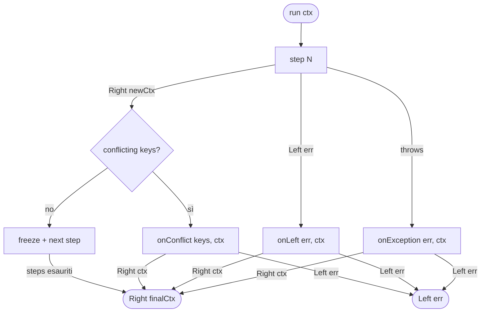

# ADR-001: Pipeline con Railway Oriented Programming su mini-fp

**Status:** Accepted  
**Date:** 2026-04-03  
**Author:** ngwes

---

## Context

`groucho-fp` deve fornire un pattern pipeline per orchestrare funzioni asincrone che possono fallire. Le funzioni devono poter arricchire uno stato comune (context) in modo additivo. Al primo fallimento la pipeline si ferma e invoca un handler dedicato. La libreria si appoggia a `mini-fp` (`@ngwes/mini-fp`) per il tipo `Either<L, R>`.

---

## Decision

Implementare una factory `createPipeline` che:

- accetta un array di **step** — funzioni `(ctx: Readonly<Ctx>) => Promise<Either<L, Ctx>>`
- accetta un options object con tre handler: `onLeft`, `onException`, `onConflict`
- restituisce un oggetto `Pipeline` con metodo `run(ctx: Ctx): Promise<Either<L, Readonly<Ctx>>>`

Tutti gli step hanno la stessa firma omogenea. Il context è l'unico stato condiviso: ogni step riceve il context corrente e restituisce un nuovo context arricchito. Gli step sono agnostici tra loro — conoscono solo `Ctx` e `L`, non si importano a vicenda.

I tre handler seguono tutti lo stesso pattern — ricevono informazioni sull'errore più il context al momento del fallimento, e restituiscono `Promise<Either<L, Ctx>>`. Possono quindi **recuperare** (restituendo `Right`) o propagare il fallimento (restituendo `Left`). Il loro valore di ritorno diventa il risultato di `run`.

**Il cleanup di risorse** (rollback, chiusura connessioni) va fatto negli handler — la pipeline non ha meccanismi di rollback autonomi.

### Tipi pubblici

```typescript
type Step<L, Ctx> = (ctx: Readonly<Ctx>) => Promise<Either<L, Ctx>>;

interface PipelineOptions<L, Ctx> {
  onLeft:     (err: L,                               ctx: Readonly<Ctx>) => Promise<Either<L, Ctx>>;
  onException:(err: unknown,                         ctx: Readonly<Ctx>) => Promise<Either<L, Ctx>>;
  onConflict: (conflictingKeys: ReadonlyArray<string>, ctx: Readonly<Ctx>) => Promise<Either<L, Ctx>>;
}

interface Pipeline<L, Ctx> {
  run(ctx: Ctx): Promise<Either<L, Readonly<Ctx>>>;
}

function createPipeline<L, Ctx extends object>(
  steps: ReadonlyArray<Step<L, Ctx>>,
  options: PipelineOptions<L, Ctx>
): Pipeline<L, Ctx>;
```

### Flusso di esecuzione



### Loop di esecuzione interno

```typescript
async run(ctx: Ctx): Promise<Either<L, Readonly<Ctx>>> {
  let current: Readonly<Ctx> = Object.freeze({ ...ctx });

  for (const step of steps) {
    let result: Either<L, Ctx>;
    try {
      result = await step(current);
    } catch (err) {
      return options.onException(err, current);
    }

    if (result.isLeft()) {
      return options.onLeft(result.unwrapLeft(), current);
    }

    const next = result.unwrapRight();
    const conflictingKeys = (Object.keys(next) as Array<keyof Ctx>).filter(
      (k) => current[k] !== undefined && next[k] !== current[k]
    );

    if (conflictingKeys.length > 0) {
      return options.onConflict(conflictingKeys as string[], current);
    }

    current = Object.freeze(next);
  }

  return Either.right(current);
}
```

### Esempio d'uso

```typescript
type AppError =
  | { tag: 'validation'; message: string }
  | { tag: 'not_found';  userId: string }
  | { tag: 'send_failed' };

type AppContext = {
  db:     Database;
  mailer: Mailer;
  userId: string;

  validatedId?: string;               // aggiunto da validateUserId
  user?:        { id: string; email: string }; // aggiunto da fetchUser
};

const pipeline = createPipeline<AppError, AppContext>(
  [validateUserId, fetchUser, sendWelcomeEmail],
  {
    onLeft: async (err, ctx) => {
      await ctx.db.rollback();
      return Either.left(err);
    },
    onException: async (err, ctx) => {
      await ctx.db.rollback();
      console.error('Unexpected crash', err);
      return Either.left({ tag: 'send_failed' }); // o un errore generico
    },
    onConflict: async (keys, ctx) => {
      console.error('Conflict on keys:', keys);
      return Either.left({ tag: 'validation', message: `conflict: ${keys.join(', ')}` });
    },
  }
);

const result = await pipeline.run({ db, mailer, userId: req.params.id });

result.match(
  (finalCtx) => res.json({ userId: finalCtx.user?.id }),
  (err)      => res.status(400).json(err),
);
```

---

## Consequences

### Positive

- Firma degli step **omogenea e agnostica**: ogni step conosce solo `Ctx` e `L`, non ha dipendenze dagli altri step
- I tre handler seguono lo stesso pattern: `(errorInfo, ctx) => Promise<Either<L, Ctx>>` — possono recuperare (Right) o propagare (Left)
- `run` restituisce `Either` → il chiamante reagisce programmaticamente senza accoppiamento ai side effect
- `Object.freeze` + conflict detection garantiscono l'immutabilità delle scritture precedenti a runtime

### Negative / Trade-off

- `Ctx` deve dichiarare upfront tutti i campi possibili, alcuni opzionali — TypeScript non garantisce a compile-time che un campo opzionale sia presente quando lo step ne ha bisogno
- La conflict detection è solo runtime — non c'è garanzia statica che uno step non sovrascriva un campo precedente
- **`Object.freeze` è shallow**: oggetti annidati in `Ctx` restano mutabili in profondità
- Il cleanup è responsabilità degli handler — la pipeline non ha rollback automatico

### Edge case documentati

- **Pipeline vuota**: `createPipeline([], options).run(ctx)` → restituisce `Right(ctx)` senza invocare handler
- **Handler che lancia**: l'eccezione si propaga al chiamante di `run`
- **Handler che restituisce `Right`**: il valore diventa il risultato finale di `run` — la pipeline non riprende gli step successivi

---

## Alternatives considered

- **`PipelineError<L>` come tipo unico** — scartato: obbliga lo switch sul tag; handler separati con tipo specifico sono più diretti
- **Variadic generics per Ctx** — scartato: complessità TypeScript eccessiva; il beneficio (no campi opzionali) non giustifica la perdita di leggibilità e la difficoltà di manutenzione
- **`run` restituisce `Promise<void>`** — scartato: il chiamante non può reagire programmaticamente al risultato
- **Step restituisce `Partial<Ctx>`** — scartato: in favore del ritorno del Ctx completo, coerente con la firma degli handler
- **L per step con union automatica** — scartato: un `L` condiviso (discriminated union) è la pratica standard
