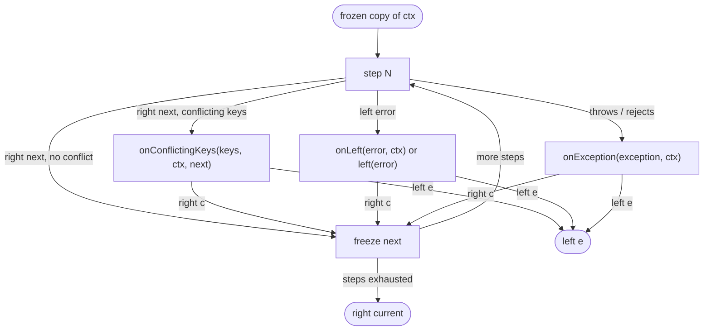

# ADR-003: mini-fp 2, recoverable hooks and load errors as values

**Status:** Accepted  
**Date:** 2026-11-01  
**Author:** ngwes  
**Supersedes in part:** [ADR-001](ADR-001-pipeline-design.md), [ADR-002](ADR-002-dynamic-step-loading.md)

---

## Context

`@ngwes/mini-fp` 2.0 made `EitherAsync` mirror `Either` (same methods, awaitable as a `PromiseLike<Either>`), made `Try` / `TryAsync` lazy, and added a prelude (`right`, `left`, ...) and helpers (`foldAsync`, `which`, `toOption`, `sequenceValidate`). groucho-fp 1.x was written against mini-fp 1.x and had drifted from ADR-001 and ADR-002:

- `Pipeline` wrapped its result in a native `Promise`, a workaround for mini-fp 1.5 returning an `EitherAsync`.
- Steps and hooks had to return a `Promise<Either>`, even when they had nothing to await.
- The hooks did not agree with each other: `onLeft` and `onConflictingKeys` returning `right` continued with the next step, `onException` returning `right` ended the pipeline. ADR-001 says all three end it.
- `onConflictingKeys` only received the keys and the previous context, so it could not accept the step's output.
- The context a recovering `onLeft` returned went through the conflict check (so `onConflictingKeys` could run on a hook's overwrite), while the other hooks' contexts did not.
- Conflict detection only looked at the keys of the returned context: a step that dropped a key was not caught.
- The caller's initial object was frozen in place.
- The loaders threw on a missing file or a broken module, and silently skipped a module with no usable export, although ADR-002 promised an error. They named the error type `L` while the pipeline uses `E`.

Version 2.0.0 is a breaking release: users may have to change their code, so these can be fixed rather than worked around.

---

## Decision

Rebuild groucho-fp on mini-fp 2 and use mini-fp's types in the public API.

### Public types

```typescript
import type { Either, EitherAsync } from "@ngwes/mini-fp";

type StepResult<E, Ctx> = Either<E, Ctx> | PromiseLike<Either<E, Ctx>>;

type Step<E, Ctx> = (ctx: Readonly<Ctx>) => StepResult<E, Ctx>;

interface PipelineOptions<E, Ctx extends object> {
  onLeft?: (error: E, ctx: Readonly<Ctx>) => StepResult<E, Ctx>;
  onException: (exception: unknown, ctx: Readonly<Ctx>) => StepResult<E, Ctx>;
  onConflictingKeys: (
    keys: ReadonlyArray<keyof Ctx & string>,
    ctx: Readonly<Ctx>,   // the context the step received
    next: Readonly<Ctx>,  // the context the step returned
  ) => StepResult<E, Ctx>;
}

function Pipeline<E, Ctx extends object>(
  ctx: Ctx,
  steps: ReadonlyArray<Step<E, Ctx>>,
  options: PipelineOptions<E, Ctx>,
): EitherAsync<E, Readonly<Ctx>>;

type LoadError =
  | { tag: "not-found"; path: string; cause: unknown }
  | { tag: "import-failed"; path: string; cause: unknown }
  | { tag: "invalid-export"; path: string; detail: string };

function loadSteps<E, Ctx>(
  paths: ReadonlyArray<string>,
): EitherAsync<ReadonlyArray<LoadError>, ReadonlyArray<Step<E, Ctx>>>;

function loadStepsFromDir<E, Ctx>(
  dir: string,
  options?: { pattern?: RegExp },
): EitherAsync<ReadonlyArray<LoadError>, ReadonlyArray<Step<E, Ctx>>>;
```

The pipeline is the `Pipeline(ctx, steps, options)` function that 1.x shipped, not ADR-001's `createPipeline(...).run(ctx)`.

### The result is an `EitherAsync`

`Pipeline` returns the `EitherAsync` its implementation builds. It is a `PromiseLike<Either>`, so `await Pipeline(...)` still gives an `Either`, and the caller can chain `map`, `mapLeft`, `onLeft`, `match` before awaiting. The native-`Promise` workaround is gone.

### Steps and hooks return a `StepResult`

A step or a hook may return an `Either`, a `Promise<Either>` or an `EitherAsync`: anything that is an `Either` or awaits to one. Sync steps no longer need `async`, and mini-fp chains (`Option.fromAsync(...).toEither(...).map(...)`) can be returned as they are.

### Every hook can recover or stop

The three hooks follow one rule:

- a hook returning **`right(ctx)`** continues with the **next step**, using `ctx` (frozen) as the current context;
- a hook returning **`left(error)`** stops the pipeline; that `left` is the result.

This holds for `onException` too. `onLeft` is optional: without it, a step's `left` stops the pipeline unchanged.



### `onConflictingKeys(keys, ctx, next)`

The hook receives the context the step returned as `next`, so it can accept the step's output (`right(next)`), keep the previous context (`right(ctx)`) or stop (`left(...)`). The keys are typed `keyof Ctx & string`.

### A hook's output is not conflict-checked

The context a hook returns becomes the current context without a conflict check: the hook is the arbiter. It is frozen like any other context. This holds for `onLeft` too, whose output 1.x did check.

### A throwing hook rejects the result

Only the step runs inside the exception boundary. A hook that throws or rejects is not routed to another hook: the returned `EitherAsync` rejects with that error. This keeps ADR-001's "a handler that throws propagates to the caller" and rules out hook loops.

### Freeze a copy

The pipeline freezes a shallow copy of the initial context (`Object.freeze({ ...ctx })`) and of every context it keeps. The caller's object is not frozen. Because the copy is a plain object, a context should be a plain object: class prototypes are not kept.

### Conflict detection includes dropped keys

A key conflicts when the current context holds a value for it (anything but `undefined`) and the returned context holds a different one (`!==`) or no longer has it. The check walks the current context's keys, so a dropped key is caught. Writing a key that was `undefined` is not a conflict: ADR-001's "initialise step outputs as `undefined`" still holds.

### Loaders return load errors as values

- `loadSteps` and `loadStepsFromDir` never throw. They return `right(steps)`, or `left` of every `LoadError`.
- **Accumulation**: every file is attempted and every failure is reported, in path order (`Validate` + `sequenceValidate`). Steps keep path order (`loadSteps`) and file-name order (`loadStepsFromDir`).
- **Existence first**: `importModule` checks that the file exists (`fs.access`) before importing it. A missing file is `not-found`; a file that exists but fails to import (syntax error, throwing module, missing dependency of the step) is `import-failed`. This avoids guessing from jiti's or Node's error codes, where a missing dependency and a missing step file look alike. A directory given to `loadStepsFromDir` that is missing or cannot be read is one `not-found` error; an empty one is `right([])`.
- **Valid modules**: the `steps` export if present, else `default`; it must be a function or an array of functions. An empty array is valid. Anything else, including a module with neither export or whose exports are `null` / `undefined`, is `invalid-export` with a `detail` saying what was found. This is what ADR-002 promised.
- **Default pattern**: `.ts`, `.js`, `.mjs` and `.cjs` files, except `.d.ts`, `.test.*` and `.spec.*` files. Because one non-step file now fails the whole load, the default skips the files most likely to sit next to steps by accident. A steps folder should hold only step files, or the caller passes a `pattern`.
- The type parameters are named `E` and `Ctx`, like the pipeline's.

### Internals

mini-fp 2 is used where it reads well: the step loop is a `foldAsync` of `bindAsync` over an `EitherAsync`, the exception boundary is `TryAsync.runAsync(...).match(...)`, which hands the exception to `onException` (or to a `LoadError`) as is and calls it outside the boundary (a step or a module may throw `undefined`, which a `left` cannot hold), the conflict check returns an `Option` (`toOption`), the export check uses `which`, the loaders accumulate with `Validate`.

---

## Consequences

### Positive

- **One rule for hooks**: right continues, left stops, for all three. A hook can recover with a default and let the rest of the pipeline run.
- **mini-fp end to end**: the pipeline result and the loaders' result chain directly (`loadStepsFromDir(...).mapLeft(...).bindAsync(steps => Pipeline(...))`).
- **Less ceremony**: steps and hooks can be sync; `onLeft` can be left out.
- **Load failures are data**: all bad files are reported at once, each with a tag the caller can `switch` on.
- **Safer conflict detection**: dropped keys are caught, and `onConflictingKeys` can accept a deliberate overwrite.
- **The caller's object stays mutable**: the pipeline does not freeze what it does not own.

### Negative / Trade-offs

- **Breaking release**: callers must handle an `EitherAsync` result, the new hook semantics (`onException` returning `right` now continues), the new `onConflictingKeys` parameters and the loaders' `left` instead of an exception.
- **One non-step file fails a directory load**: a helper or type-only module matched by the pattern is an `invalid-export`. The default pattern and the docs reduce the risk; it cannot be removed without silently skipping files again.
- **Hooks are trusted**: a hook can return a context that overwrites earlier values, and nothing checks it. A recovering `onLeft` that overwrote a value triggered `onConflictingKeys` in 1.x; it no longer does.
- **Plain objects only**: the copy drops class prototypes.
- **The existence check is a separate step**: a file deleted between the check and the import is reported as `import-failed`.
- **mini-fp 2 has no empty `Either`**: `right(undefined)` and `left(undefined)` throw, so a step must always return a context and a hook's `left` must carry a real error value.

### Documented edge cases

- **Empty pipeline**: `right` of the frozen copy of `ctx`; no hook runs.
- **Hook returning `right`**: the pipeline continues with the next step (ADR-001 said it ended the pipeline).
- **Hook that throws or rejects**: the result rejects with that error; no other hook runs.
- **Step whose promise rejects**: same as a throw, `onException` runs.
- **Step that throws `undefined` or rejects with no reason**: `onException` runs with `undefined`.
- **Module that throws `null` on import**: `import-failed` with a `null` cause; one whose exports are `null` is `invalid-export`.
- **`null` is a written value**: changing it later conflicts. Only `undefined` counts as not written.
- **New object, same content**: a conflict, since the comparison is `!==`.
- **Empty array export**: valid, zero steps.
- **Array export with a non-function element**: `invalid-export`.

---

## Alternatives considered

- **Keep returning a native `Promise`** — rejected: it hid the `EitherAsync` the pipeline already builds and forced callers to re-wrap the result to chain on it.
- **Keep `onException` terminal** — rejected: three hooks with two rules was the main inconsistency. If a hook can recover, the pipeline should continue the same way for all of them.
- **Conflict-check the hook's output** — rejected: the hook is where the caller decides; checking its output again could call `onConflictingKeys` from inside a hook and loop.
- **Route a throwing hook to `onException`** — rejected for the same reason (hook loops), and it would hide bugs in the hooks.
- **Stop at the first load error** — rejected: fixing a steps folder one file per run is slow; reporting all errors costs nothing extra.
- **Classify load errors from jiti / Node error codes** (`ENOENT`, `ERR_MODULE_NOT_FOUND`) — rejected: the same codes are raised when a step file imports a missing dependency, so a broken step would be reported as a missing one.
- **Keep skipping modules without a usable export** — rejected: a typo in an export name silently removed a step from the pipeline.
- **Deep-freeze the context** — rejected: ADR-001 already accepts a shallow freeze; a deep one costs a walk on every step, and nested objects owned by the caller (connections, clients) must stay usable.
